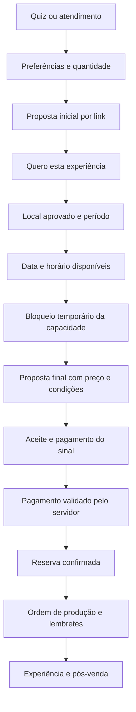
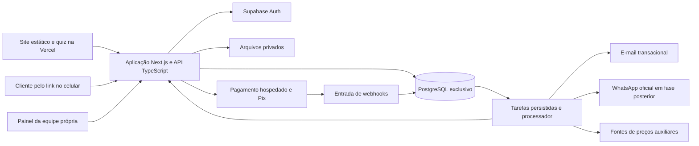

# Plano de arquitetura e operação — Descomplica Guarujá

**Data:** 26/09/2026. **Status:** proposta de arquitetura, sem implantação do sistema transacional. **Escopo:** equipe própria, poucos pedidos iniciais, A Dois para duas pessoas e demais coleções de duas a oito pessoas. Autorizações e locais serão definidos com SETUR e órgãos competentes.

## 1. Decisão executiva

Preservar a home estática e seu SEO. Construir uma aplicação de operação e reserva em `app.descomplicaguaruja.com.br`, no mesmo repositório, com deploy independente. Usar um **monólito modular em TypeScript/Next.js**, PostgreSQL gerenciado em **um novo projeto Supabase exclusivo do Descomplica**, autenticação, armazenamento privado e um único processador de tarefas persistidas no banco. Manter Vercel como hospedagem.

A aplicação reúne os seis módulos: clientes, propostas, agenda, contratos/pagamentos, produção e pós-venda/gestão. Compartilham banco e regras de negócio. Não há marketplace, cadastro público de fornecedores, divisão de pagamentos entre prestadores ou agenda de fornecedores.

O site continua funcionando mesmo se o painel estiver em manutenção. A aplicação pode evoluir sem reescrever a apresentação comercial. Dois deploys não significam dois backends: só a aplicação transacional executa regras e acessa os dados operacionais.

**A automação pretendida:** publicar uma oferta validada uma vez e deixar o sistema conduzir os pedidos que respeitem suas regras. A equipe alimenta custos, disponibilidade e capacidade e atende uma fila de exceções. Automatizar execução física, segurança do local ou criação afetiva da surpresa não é uma promessa do sistema.

**Primeiro resultado utilizável:** um contato recebido vira um atendimento persistido, uma proposta versionada e um link pelo qual o cliente escolhe um horário realmente disponível. Aceite e pagamento confirmam a reserva, que gera a ordem de produção.

## 2. Auditoria do estado atual

Repositório consultado pelo conector GitHub e comparado ao checkout local: `ghcastellano/descomplica-guaruja`, base `3134eb464f49fd0ed35e45d9ade72786db523913`.

| Evidência | Estado atual | Consequência para o plano |
|---|---|---|
| `index.html`, 1.411 linhas | HTML, estilos, catálogo, quiz, estimativas e integrações no mesmo arquivo | Separar os dados e regras gradualmente. Não reescrever a home para iniciar o sistema. |
| `index.html:1079` e `1403` | POST ao Apps Script em `no-cors` | A página não consegue conferir a gravação. Trocar por API que confirma persistência e retorna protocolo. |
| Captura de contato no fim do quiz | Mostra “Anotado” antes de confirmação do servidor | Só mostrar sucesso depois da confirmação. Permitir nova tentativa sem duplicar o contato. |
| `PRICE_ESTIMATES`, `packageForGuests()` e JSON de custos | 11 pacotes, 59 estimativas por quantidade | Importar como referência. Não converter automaticamente estimativas em ofertas firmes. |
| `deck.js:118–134` | Pousada mantém rascunho na aba e preenche WhatsApp/e-mail | Não existe pedido centralizado a partir desses campos. Integrar quando o módulo de parcerias entrar no escopo. |
| `vercel.json` | URLs limpas, cache de imagens/fontes e alguns cabeçalhos de segurança | Preservar. Novas rotas privadas exigem política própria de cache e segurança. |
| `tests/` | Regressões estáticas, quiz, decks e formulário | Reaproveitar a cobertura. Adicionar testes de transação e concorrência ao novo sistema. |
| Sem aplicação/API operacional e sem `.github/workflows` neste checkout | Site não contém autenticação, reservas ou pagamentos transacionais | Implantar pipeline de verificação antes de publicar o backend. |
| Contexto documentado do Supabase antigo | Projeto compartilhado com outro negócio, fora do site atual | Criar projeto isolado. Não reaproveitar credenciais, tabelas ou usuários sem migração expressamente revisada. |

Não auditamos dados, políticas ou configuração do banco antigo. Não verificamos a entrega real de leads na planilha nesta revisão. Ausência de confirmação no navegador não comprova perda de todos os envios.

### Divergências operacionais que impedem orçamento automático hoje

1. O modelo anterior provisiona ajuda externa a partir de cinco participantes. O novo modelo precisa usar escala e custo da **equipe própria**.
2. Há pacotes com fotografia/vídeo profissionais. Só poderão ser vendidos automaticamente se a equipe tiver habilidade, equipamento e capacidade confirmados para entregar o escopo. Até lá, ficam sob análise ou indisponíveis no fluxo automático.
3. O rateio histórico usa R$ 900 de fixos divididos por 20 eventos/mês. Isso não representa a operação inicial de poucos pedidos.
4. Horas dos sócios, acervo, perdas e provisão fiscal ainda são premissas. O plano não altera os preços públicos nesta etapa.
5. A home contém afirmação de escassez do pôr do sol sem conexão com agenda. Na implantação, trocar por disponibilidade verdadeira ou texto sem escassez não comprovada.

## 3. Jornada do cliente e confirmação da proposta

### Fluxo recomendado



**Distinção necessária:** o primeiro clique confirma a preferência pela experiência, sem reservar data nem aceitar um preço que ainda pode mudar. O aceite comercial definitivo acontece após local, data, duração e extras. Isso respeita o fluxo desejado de “gostei da proposta, agora vou agendar” sem cobrar uma oferta incompleta.

Se a proposta já incluir data e local, o link vai direto ao resumo final, mas o servidor revalida a capacidade. Uma proposta enviada não bloqueia agenda indefinidamente.

### Telas, todas feitas para celular

| Tela | Conteúdo e comportamento |
|---|---|
| Proposta por link | Experiência, número de participantes, duração, inclusões, exclusões, faixa ou preço fechado claramente identificado, validade e próximo passo. |
| Personalização | Preferências, ocasião, restrições alimentares e acessibilidade necessárias. Separar informação da pessoa homenageada e contato do organizador para preservar surpresa. |
| Local e período | Apenas pontos aprovados, fotos verificadas, acesso, plano de chuva e eventuais diferenças de preço. Manhã/tarde/pôr do sol/noite conforme oferta e local. |
| Disponibilidade | Calendário mensal e lista de horários, com alternativa acessível em lista. Mostrar duração e término. Nenhum dado de outro cliente. |
| Revisão e aceite | Versão final, data/hora/local, total, sinal e saldo, política de remarcação/cancelamento e contato. Exigir novo aceite se houver mudança material. |
| Pagamento | Pix copia e cola/QR ou checkout hospedado. Estado “aguardando confirmação”. Não tratar retorno do navegador como confirmação. |
| Minha experiência | Status real, instruções, comprovantes, saldo, pedido de alteração e contato. Sem detalhes internos da surpresa. |

A pessoa abre o link em qualquer celular, sem instalar aplicativo. Não precisa criar senha. Uma verificação por código no contato confirmado protege dados e o aceite. Rascunhos persistem no servidor após identificação; cache local não é o registro oficial. Botões com área mínima de 44px, etiquetas visíveis, teclado numérico, foco e mensagens de erro acessíveis. Layout de 320px a desktop e teste real em Safari/iOS e Chrome/Android.

### Regras de produto

- A Dois: exatamente 2. Celebrar, Entre Amigas e Pedido: 2 a 8. Em Pedido, o casal conta no total.
- Não permitir 9–50 participantes no fluxo de compra atual. Esse pedido pode ser registrado como interesse futuro, sem preço, cobrança ou garantia de atendimento.
- O cliente escolhe uma janela preferida e depois um horário concreto. “Pôr do sol” não é um horário fixo para o ano todo.
- Surpresa não altera sem consentimento alimentação, valor, local, acessibilidade ou requisitos essenciais.
- Proposta aprovada congela a versão dos preços e termos. Alterações futuras de catálogo não mudam um contrato aceito.

## 4. Agenda de equipe própria e locais

### Fonte de verdade

A disponibilidade nasce no PostgreSQL. Google Calendar, se integrado posteriormente, é uma visualização auxiliar. Um evento arrastado no calendário externo não pode sobrescrever uma reserva confirmada sem validação.

A agenda reserva **pessoas, kits reutilizáveis, transporte e o ponto autorizado**, quando aplicável. Fase inicial: uma equipe/unidade de atendimento, permitindo um evento por vez. É uma configuração conservadora proposta, que deve ser confirmada com vocês antes de abrir reservas. A capacidade aumenta por pessoas e recursos efetivamente disponíveis, não por número arbitrário de vagas na tela.

### Cálculo de horários

Para cada oferta e local, configurar: duração, preparação, montagem, desmontagem, limpeza, deslocamento, antecedência, dias de operação, janelas permitidas, indisponibilidades e capacidade.

`intervalo operacional = preparação/deslocamento necessários + montagem + experiência + desmontagem/retorno/limpeza necessários`

Não somar deslocamento duas vezes: definir explicitamente se o bloqueio é base-local-base ou transição entre locais. No início, usar base-local-base conservador e uma matriz de tempos validada em campo. Depois, otimizar sequenciamento com dados reais. A consulta considera também o evento anterior e o seguinte.

Exemplo didático: atendimento das 16h às 18h, com montagem das 15h às 16h e desmontagem até 18h30, não deixa essa equipe livre às 17h. O deslocamento é incluído antes/depois conforme a matriz operacional. Valores ilustrativos, não produtividade medida.

- Armazenar instantes em UTC, apresentar e interpretar regras em `America/Sao_Paulo`.
- Associar pôr do sol a cálculo astronômico local, coordenadas verificadas e duração da oferta. Relevo, nuvens e visibilidade do horizonte continuam condições reais, não promessa de céu aberto.
- Não exibir “noite” quando o ponto não tiver autorização, iluminação ou capacidade aprovada para esse período.
- Cancelamentos administrativos, manutenção, férias e ausência de pessoal bloqueiam recursos.
- Temporada, feriados, chuva, vento e condições do local podem restringir a agenda. Alertas não autorizam realização automaticamente.
- Antecedência mínima, horizonte de agendamento e duração do bloqueio são configurações a aprovar. Sugestão de teste: mínimo de 96h para ofertas padrão e bloqueio de checkout de 15 minutos. Personalizações complexas têm prazo próprio.

### Concorrência e bloqueios temporários

`GET /availability` informa candidatos. Somente `POST /holds` pode reservá-los, após recalcular preço/capacidade no servidor. Não confiar na lista antiga que estava na tela.

Cada recurso recebe um intervalo `tstzrange` semiaberto `[início,fim)`. Restrições de exclusão GiST impedem intervalos sobrepostos para o mesmo recurso e estados bloqueantes. Recursos são alocados na mesma transação, em ordem consistente para evitar deadlock. Para estoque quantitativo, bloquear as linhas relevantes e validar saldo/reservas atomicamente. [PostgreSQL: intervalos e exclusão](https://www.postgresql.org/docs/current/rangetypes.html).

A restrição não pode depender de `now()` em seu predicado. Um bloqueio vencido deve mudar explicitamente para `expired`, tanto no processamento periódico quanto antes de uma nova tentativa de alocação, dentro da transação e com os bloqueios apropriados. O relógio autoritativo é o do banco.

Resultado esperado: duas pessoas tentando pagar pelo último horário não conseguem duas reservas. A segunda recebe alternativas. Uma única reserva pode consumir vários recursos sem deixar alocações parciais se a transação falhar.

### Locais candidatos

Esta é uma priorização operacional proposta, não um ranking oficial nem autorização. Todos começam com `status = candidate` e invisíveis ao checkout. Só ativar após vistoria, capacidade, regras e aprovação registradas. A SETUR pode orientar a tramitação, mas não se presume que seja o único órgão competente.

| Candidato | Uso a avaliar | Condições antes de ativar |
|---|---|---|
| Astúrias | Experiências pequenas na orla, pela proximidade com o núcleo inicial | Ponto exato, circulação, acesso de montagem, faixa de areia, limpeza e autorizações. |
| Pitangueiras | Experiências associadas à região central e hospedagens | Movimento, ruído, estacionamento/carga e horários de menor interferência. |
| Tombo | Ambientação ligada à paisagem e identidade de praia | Regras ambientais e do trecho, vento, montagem, circulação e horários. Não oferecer atividades de banho. |
| Guaiúba | Alternativa para famílias e ambientação intimista | Acesso, lotação do fim de semana, transporte, condições e permissões do ponto. |
| Enseada | Ampliação da cobertura de hospedagens | Selecionar trecho específico e validar tempos maiores de deslocamento. |
| Pousada/espaço privado autorizado | Base inicial e alternativa coberta | Acordo de uso, capacidade, acessibilidade, custos e disponibilidade vinculados ao sistema. |
| Mirantes das Galhetas e da Campina | Eventual complemento de visita ou registro | Não pressupor área para montagem, permanência prolongada ou exclusividade. Exigem análise própria. |
| Pernambuco e pontos de acesso mais difícil | Expansão posterior | Evitar aumentar o raio e a complexidade antes de medir a operação inicial. |

Referências descritivas: [Praias do Guarujá](https://www.guaruja.sp.gov.br/praias) e [Mirante das Galhetas](https://www.guaruja.sp.gov.br/com-piso-de-vidro-mirante-das-galhetas-abre-ao-publico-em-guaruja). Conferir condições atuais em campo, sem assumir que descrições turísticas comprovem aptidão para eventos.

Cada local guarda coordenadas verificadas, instrução de encontro, capacidade, períodos permitidos, documento/validade da autorização, responsável, acessibilidade, regras de som/alimentos/resíduos, plano coberto e taxa quando aplicável. Expiração de autorização bloqueia novas reservas e gera análise das existentes.

## 5. Catálogo, composição e preços

### O que será alimentado

1. **Oferta:** coleção, nível, quantidade permitida, duração, fotos, inclusões, exclusões e períodos.
2. **Ficha de composição:** insumos por pessoa/grupo, embalagens, perdas, kits reutilizáveis e tarefas.
3. **Equipe:** pessoas, habilidades, escala, disponibilidade e custo de trabalho.
4. **Locais:** pontos aprovados e condições operacionais.
5. **Políticas:** validade da proposta, antecedência, sinal/saldo, alteração e contingência.

Exemplos de componentes para detalhar, sem prometer novos itens no catálogo: mesa e têxteis, assentos/almofadas, louças, iluminação permitida, arranjos, água e alimentos definidos em ficha, bolo/doces quando incluídos, material da surpresa, kit de limpeza e acondicionamento. Nas experiências de pedido, verificar estrutura, letras/ambientação e capacidade da equipe para registro. Alimentos precisam de porção, unidade, rendimento, conservação e restrições documentados.

### Equipe própria muda o cálculo

Cadastrar remuneração, encargos/benefícios aplicáveis, transporte/refeição, férias/ausências, treinamento e horas disponíveis. O contador confirma os componentes conforme o vínculo. Trabalho dos sócios tem custo. Se a folha mensal já estiver no custo-hora, não contabilizá-la novamente integralmente nos fixos do evento.

Usar duas leituras:

- **Por experiência:** custo incremental, custo de capacidade consumida, margem de contribuição e margem após rateio.
- **Por mês:** receita, despesas variáveis, folha real, demais fixos, ociosidade e resultado de caixa.

Simular 3, 6, 12 e 20 eventos/mês com o mix de ofertas. São cenários, não previsão. Uma margem por evento aparentemente positiva não garante que poucos eventos paguem uma equipe dedicada. Definir investimento de partida e limite de caixa para o período de validação.

### Fórmula determinística

```text
C = insumos consumidos + perdas + trabalho alocado
    + transporte + limpeza + desgaste do acervo
    + custos do local + rateio de fixos não duplicados

P = (C + contingência em reais + tarifa fixa do pagamento)
    / (1 - provisão tributária validada - taxa percentual de pagamento - margem-alvo)
```

Valores monetários em centavos ou decimal exato, nunca ponto flutuante para total/cobrança. Fórmula rejeita denominador menor ou igual a zero. Margem e markup são diferentes. Impostos dependem da operação e do regime confirmado. O percentual histórico de 10% é provisão, não alíquota validada.

Arredondamento comercial ocorre ao final. Quantidades usam faixas e custos compartilhados, sem multiplicar o total de dois convidados por quatro para chegar a oito. Nenhum custo essencial ausente pode ser tratado como zero.

### API gratuita: pesquisa, limite e decisão

**Open Prices/Open Food Facts** oferece API pública de observações de preço. Fizemos um GET de leitura em `https://prices.openfoodfacts.org/api/v1/prices?currency=BRL&size=100` em 26/09/2026. A resposta informou 72 observações e uma página, com datas entre 12/07/2024 e 24/09/2026. Nenhuma veio com Guarujá no campo de cidade. Há inclusive metadados geográficos que exigem revisão. Isso confirma a existência da API, mas não sustenta cobertura suficiente do Guarujá ou do conjunto de insumos. A data de atualização do cadastro não substitui a data da observação do preço. [Documentação oficial](https://github.com/openfoodfacts/open-prices/blob/main/API.md).

**CEAGESP** publica referências de atacado de São Paulo. Servem para tendência e comparação de hortifrúti, não equivalem ao preço entregue em Guarujá. Não foi confirmada nesta revisão uma API pública gratuita com contrato estável para integrar essas cotações. Não fazer scraping não autorizado nem tratar atacado como varejo local. [Cotações CEAGESP](https://ceagesp.gov.br/cotacoes).

**Decisão:** criar uma interface de fontes de preço e experimentar Open Prices como fonte auxiliar. O orçamento firme usa uma tabela de custos aprovada, alimentada principalmente por notas/recibos e preços de compra locais. Não há API verificada nesta pesquisa que resolva alimentação, flores, acervo, pessoal, transporte e tributos de forma completa e gratuita.

Processo proposto:

1. Importar observações em segundo plano, nunca no caminho crítico do checkout.
2. Verificar produto/SKU, marca ou equivalência permitida, quantidade da embalagem, unidade, moeda, data e localização. Converter para R$/kg, R$/L ou R$/unidade.
3. Excluir promoções sem elegibilidade, dados sem unidade, duplicatas e observações inadequadas à região. Registrar frete e prazo quando aplicáveis.
4. Calcular referência robusta somente sobre observações comparáveis. Sugestão inicial: mediana de pelo menos três observações recentes; a regra e a janela variam por categoria e precisam ser aprovadas. Uma compra real própria pode ser uma evidência melhor que essa mediana.
5. Mostrar fonte, idade, amostra e desvio para revisão. A média nacional não vira custo local automaticamente.
6. Atualizar a tabela aprovada por decisão registrada. Custos vencidos ou sem evidência pausam a venda automática da oferta afetada, mantendo solicitação sob análise.
7. Congelar a tabela/ficha usada em cada proposta. Falha da API não altera preços nem derruba a reserva; usar o último custo aprovado ainda válido.

Respeitar licenças e atribuição da fonte. Não enviar recibos internos, telefones ou dados do cliente a uma base pública. Dados de produtos do Open Food Facts não são, por si, preços. IA pode sugerir composição ou extrair recibos para conferência; não inventa custo, disponibilidade, alérgenos ou preço final.

## 6. Arquitetura técnica



### Escolhas e alternativas

| Decisão | Justificativa | Alternativa e condição para mudar |
|---|---|---|
| Manter site estático | Excelente ponto de partida para performance, SEO e custo | Migrar a home só quando publicação de catálogo ou conteúdo justificar o trabalho. |
| Next.js/TypeScript só na nova aplicação | Um projeto para portal, painel e API, componentes compartilhados e validação tipada | HTML nativo + funções seria menor no início, mas dificulta o painel e os estados transacionais. Não adicionar framework à home agora. |
| PostgreSQL/Supabase exclusivo | Transações, restrições de agenda, autenticação e arquivos no mesmo serviço gerenciado | Postgres gerenciado de outro provedor é portável. Evitar NoSQL para reservas relacionais e regras de conflito. |
| Monólito modular | Poucos pedidos e uma equipe não justificam microserviços | Extrair processador só quando duração/volume ou isolamento exigir. |
| Outbox e tarefas no Postgres | Pedido e evento de trabalho persistem juntos, sem novo serviço de fila inicial | Fila gerenciada quando houver atraso recorrente ou throughput que prejudique o banco. |
| Um PSP inicialmente | Simplifica conciliação, suporte e falhas | Segundo meio/provedor após demanda real. |
| Asaas como candidato inicial | Documentação de cobrança/Pix e webhooks adequada ao fluxo brasileiro | Confirmar cadastro, tarifas, experiência móvel, estorno e emissão fiscal em sandbox antes da escolha contratual. |
| E-mail transacional primeiro | Confirmação e recuperação sem depender do aplicativo do cliente | WhatsApp oficial depois, com consentimentos e regras/templates vigentes. `wa.me` não é envio automático. |
| Sem IA no cálculo final | Preço, reserva e cobrança precisam ser reproduzíveis | IA restrita a assistência editorial e extração com validação. |

Não contratar contas, iniciar cobranças, ativar WhatsApp, criar banco ou implantar essas peças nesta etapa de planejamento.

### Estrutura proposta do repositório

```text
/                           site atual, preservado inicialmente
  index.html
  cultura-setur.html
  deck.css, deck.js, img/, fonts/
  docs/                     planos e documentação, fora do deploy público
  tests/                    regressões do site
  app/                      novo projeto Vercel, root directory próprio
    src/app/                telas, endpoints e layouts
    src/modules/
      customers/
      catalog-pricing/
      proposals/
      scheduling/
      payments/
      production/
      reporting/
    src/server/             autorização, acesso a dados, adaptadores, tarefas
    supabase/migrations/    SQL versionado, permissões e funções transacionais
    tests/                  unidades, integrações e jornadas
  .github/workflows/        CI, verificações e deploy controlado
```

O deploy estático deve excluir `app/` e documentação interna. O deploy da aplicação tem raiz própria, arquivos públicos explícitos e variáveis exclusivas por ambiente. A home pode chamar a API da aplicação com CORS restrito ao domínio autorizado, sem credenciais para entrada de lead; CORS não substitui autenticação nem proteção contra abuso. Outra opção é uma rota de proxy no mesmo domínio, se a configuração operacional favorecer.

Catálogo público é uma projeção sem custos/margens/PII. No começo, publicar um JSON versionado gerado da versão aprovada, com atualização controlada do site. O servidor sempre recalcula o valor final. O cache do catálogo informa sua versão e nunca é autoridade de cobrança.

### Dados principais

| Domínio | Entidades e invariantes |
|---|---|
| Clientes | `customers`, `leads`, `briefings`, `consents`; telefone normalizado, finalidade e responsável. Dados sensíveis do briefing separados do cadastro geral. |
| Catálogo | `experiences`, `offer_versions`, `components`, `recipes`, `cost_observations`, `approved_costs`; versões imutáveis após uso. |
| Recursos | `staff`, `skills`, `shifts`, `resource_units`, `stock_items`, `stock_movements`; saldo e reservas auditáveis, kits contados por unidade. |
| Locais | `locations`, `location_permissions`, `operating_windows`, `travel_matrix`, `blackouts`; status aprovado e validade. |
| Propostas | `quotes`, `quote_versions`, `quote_lines`, `quote_cost_snapshots`, `access_tokens`, `acceptances`; aceite vinculado à versão e ao escopo exato. |
| Agenda | `holds`, `resource_allocations`, `bookings`, `booking_changes`; restrições de sobreposição e vencimento. |
| Financeiro | `payment_attempts`, `payments`, `refunds`, `invoice_records`, `expenses`; IDs únicos do provedor e valores reconciliáveis. |
| Produção | `work_orders`, `tasks`, `checklists`, `time_entries`, `incidents`; plano interno da surpresa com acesso restrito. |
| Automação | `webhook_inbox`, `outbox`, `jobs`, `audit_events`; eventos únicos, tentativas, prazo, estado e responsável por exceção. |
| Pós-venda | `feedback`, `attribution`; dados pessoais não entram no relatório institucional. |

Não criar multitenancy, cadastro de fornecedores ou split de pagamentos. Contatos comerciais de lojas, quando úteis a compras, são informação interna de aquisição, sem portal ou contratação pelo cliente.

### API mínima

- `POST /api/leads`: validação, limitação de abuso, persistência e protocolo. Chave de idempotência por tentativa lógica.
- `GET /api/catalog`: somente catálogo aprovado e sanitizado.
- `POST /api/proposals` e endpoints internos de revisão/publicação: autorizados para a equipe; geração automática só para regras liberadas.
- `POST /api/proposal-access/verify`: troca segura e verificação de contato. GET de link não aceita contrato nem gera cobrança.
- `GET /api/availability`: local/oferta/quantidade/período e janela limitada. Não retorna reservas de terceiros.
- `POST /api/holds`: alocação atômica de capacidade; responde conflito com alternativas.
- `POST /api/acceptances`: versão final e termos, identidade verificada, evidência e carimbo do servidor.
- `POST /api/payments`: cria ou recupera a mesma intenção de pagamento, nunca cobra por um preço vindo do navegador.
- `POST /api/webhooks/payments`: autentica, persiste uma vez e confirma recebimento rápido.
- `POST /api/booking-changes`: registra pedido de alteração; aplica política e novo aceite quando necessário.
- Endpoints internos de catálogo, escala, produção, relatórios e recuperação de falhas com permissões por função.

## 7. Estados, cobrança e recuperação de falhas

Proposta: `draft → review_required/ready → sent → accepted`, com saídas `expired`, `declined` ou `superseded`.

Reserva: `hold → awaiting_payment → confirmed → preparing → completed`, com saídas `expired`, `change_requested`, `cancelled` e `exception`. Estado de pagamento é separado do operacional. Cancelamento não significa estorno concluído.

### Regra de confirmação

A política atual é sinal de 50% e saldo até 72h antes. Manter no desenho. Ofertas com antecedência menor exigem política específica aprovada; até isso ocorrer, o sistema não as vende automaticamente. O PSP pode impor restrições de vencimento/expiração que precisam ser testadas.

A reserva só passa a `confirmed` quando há aceite válido, capacidade alocada e pagamento esperado confirmado pelo provedor. O servidor confere beneficiário/conta, moeda, valor, identificador e vínculo com a proposta.

**Pagamento depois do vencimento do bloqueio:** não confirmar cegamente. Tentar realocar recursos atomicamente; se indisponíveis, abrir exceção e oferecer alternativa ou encaminhar estorno conforme política. Informar o cliente de forma clara, sem prometer reembolso já realizado. Desativar cobranças vencidas quando o provedor permitir, mas ainda tratar pagamentos tardios.

### Eventos e tarefas confiáveis

1. Validar autenticação do webhook conforme o provedor. No Asaas, conferir `asaas-access-token`, independente da chave de API.
2. Persistir o evento com unicidade `(provider,event_id)` antes de responder 200. Se o banco falhar, retornar erro para permitir reenvio.
3. Processar fora do recebimento. Duplicatas não repetem confirmação, e-mail, reserva ou estorno. Eventos fora de ordem exigem reconciliação com o estado atual do provedor.
4. Alteração de negócio e entrada da outbox na mesma transação. Processador adquire tarefas com lease e `FOR UPDATE SKIP LOCKED`.
5. Retentativas com atraso crescente e limite. Depois, fila de exceções visível à equipe, sem perda silenciosa.
6. Após timeout de criação de cobrança, consultar a referência externa antes de repetir. Se o PSP não oferecer idempotência suficiente, reconciliar e encaminhar exceção em vez de criar uma segunda cobrança às cegas.
7. Rodar reconciliação periódica de pagamentos pendentes e recebimentos. Timeout não é recusa nem sucesso.

Entrega é “ao menos uma vez”, com efeitos idempotentes, e não promessa de execução exatamente uma vez. E-mail também exige chave/registro de envio. [Documentação oficial de webhooks do Asaas](https://docs.asaas.com/docs/webhooks-2).

### Emissão fiscal e saldo

Cadastrar dados fiscais apenas quando necessários, após a definição da empresa. Escolher emissão integrada somente depois de confirmar compatibilidade com o regime, município e provedor. O momento de emitir a nota, seus itens/código de serviço e o tratamento de sinal, saldo, cancelamento e estorno devem ser validados pela contabilidade. Recebimento de Pix não determina sozinho toda a regra fiscal.

O sistema mantém a situação da nota separada da cobrança, armazena os arquivos fiscais privados e oferece reprocessamento/alternativa operacional se o emissor estiver indisponível. Nunca emitir duplicado após timeout. O painel financeiro concilia sinal, saldo, recebimentos, taxas, estornos e notas. Inadimplência gera alerta e aplicação da política aprovada, sem cancelamento irreversível silencioso.

### Produção disparada pela confirmação

Criar ordem com escala, endereço, horários, ficha de composição congelada, lista de separação, compras faltantes, montagem, limpeza e plano de chuva. Atribuir responsáveis. Lembretes incluem saldo, confirmação do local, briefing pendente e tarefas atrasadas. Reposição/compra automática com pagamento a terceiros não entra no MVP.

O funcionário vê sua escala, tarefas e dados necessários para atender. O plano da surpresa só aparece a quem precisa executá-lo. Alterações de quantidade ou local recalculam capacidade, custo e tarefas; não editam silenciosamente o combinado.

## 8. Segurança, privacidade e continuidade

- **Identidade:** equipe entra por convite, MFA para gestão e financeiro, revogação imediata e papéis separados. Cliente verifica o contato para informações pessoais e aceite. Não usar senha compartilhada.
- **Propostas por link:** token aleatório de alta entropia, armazenado como hash, expirável e revogável. Visualização inicial só com informação mínima. Ações sensíveis exigem verificação. GET não consome token nem altera estado, evitando problemas com prévias de WhatsApp/e-mail.
- **Vazamento por URL:** `Referrer-Policy: no-referrer`, `Cache-Control: private, no-store`, `noindex`, sem Meta/GA nas páginas privadas. Redigir tokens nos logs inclusive de infraestrutura. Trocar token por sessão curta via POST e limpar a URL quando cabível. Prévia compartilhada genérica, sem nome, história ou data pessoal.
- **Autorização:** toda consulta/mutação revalida identidade e escopo no servidor. Não confiar em esconder botões nem no middleware sozinho. Clientes só veem suas propostas/reservas. Funcionários só veem atribuições permitidas.
- **Banco:** RLS e privilégios mínimos em tabelas expostas. Preferir consultas com identidade do usuário e funções transacionais restritas. Credencial privilegiada somente em adaptadores de servidor para tarefas específicas, nunca no cliente. Uso de `service_role` ignora RLS e precisa de autorização explícita, não de confiança na política de tabela.
- **Segregação:** custos, margem, informação de saúde/alergias e plano da surpresa em estruturas/DTOs separados. RLS por linha não protege colunas por si só. Views com comportamento e permissões revisados. Proibir `SELECT *` nas respostas públicas.
- **Entradas:** validação de esquema, limites de tamanho, consultas parametrizadas, escape de conteúdo e proteção de CSV contra fórmula. CSP na aplicação, CSRF/origin nos POST com sessão, cookies HttpOnly/Secure/SameSite e rate limiting compartilhado. Segredo nunca em `NEXT_PUBLIC_*`.
- **Abuso:** limitar leads, códigos, busca de disponibilidade e criação de holds por identidade e origem. Um cliente não pode esgotar a agenda gerando bloqueios ilimitados. CAPTCHA adaptativo na entrada pública quando necessário, com validação no servidor.
- **Arquivos:** buckets privados, URLs assinadas curtas, tamanho/tipo permitido, validação real de conteúdo. Evitar anexos no primeiro MVP se não forem necessários. Comprovante enviado pelo cliente não confirma pagamento.
- **Dados:** coletar o mínimo, registrar finalidade, separar autorização de imagem e marketing do contrato e permitir atendimento de solicitações de privacidade. Definir retenção com assessoria jurídica/contábil, incluindo obrigações de guarda e exclusão. Não inventar um prazo legal único para tudo.
- **Surpresa:** nunca expor detalhes em notificações na tela bloqueada, assunto de e-mail ou canal da pessoa homenageada sem combinado.
- **Ambientes:** produção e homologação separados, testes só com dados fictícios, chaves distintas e pagamentos em sandbox. Nenhuma cópia indiscriminada de clientes para previews.
- **Auditoria:** ator, horário, motivo e versão para preço, aceite, agenda, status financeiro e mudança de política. Logs sem texto integral de briefing, token ou telefone.

Referências: [Supabase RLS](https://supabase.com/docs/guides/database/postgres/row-level-security) e [Next.js, segurança de dados](https://nextjs.org/docs/app/guides/data-security).

### Continuidade

Definir e testar restauração do banco e dos arquivos, não só conferir que “há backup”. Guardar exportação independente e criptografada com retenção e acesso restritos. Backup do banco não deve ser presumido como backup dos objetos de Storage.

Proposta inicial para ambiente piloto: RPO até 24h e RTO até 4h, sujeitos à aceitação do negócio e teste de restauração. Isso significa admitir perda de até um dia de alterações em desastre; se inaceitável para reservas pagas, contratar/configurar PITR ou solução equivalente antes de liberar o checkout. Meta recomendada para operação automatizada com pagamentos: RPO até 15 minutos, a orçar e comprovar. Retenção de webhooks e conciliação do PSP ajudam a recuperar pagamentos, mas não reconstituem sozinhas todo o briefing/contrato perdido.

Criar procedimento para indisponibilidade: suspender nova confirmação quando não puder verificar capacidade, manter canal de atendimento e registrar pendências de forma controlada. Nunca “confirmar offline e acertar depois” sem checar conflitos.

## 9. Performance, escala e observabilidade

Metas de engenharia propostas, a medir sob rede móvel e carga representativa:

| Requisito | Meta inicial de aceitação |
|---|---|
| Experiência web | LCP p75 até 2,5s, INP p75 até 200ms, CLS até 0,1 nas páginas principais. |
| API de agenda | p95 até 800ms com 20 consultas simultâneas no cenário de teste; medir e ajustar índices. |
| Persistência de lead | Resposta com protocolo em até 2s p95, sem incluir tempo de entrega de mensagem. |
| Webhook | Persistir e responder em até 2s p95; processamento recuperável após a resposta. |
| Tarefas | Atraso normal até 2 minutos; alertar se passar de 5 minutos ou houver fila parada. |
| Consistência | Zero reservas conflitantes no teste concorrente e zero efeitos duplicados por webhook repetido. |
| Acessibilidade | WCAG 2.2 AA como objetivo, teclado, leitor de tela e testes móveis nas jornadas críticas. |

Essas metas não são resultados já medidos do futuro sistema nem SLA contratual.

Manter imagens responsivas WebP/JPEG, fontes locais e pouca hidratação. Carregar calendário apenas quando necessário. Consultas de disponibilidade por janela limitada e índices em local/data, recurso/intervalo e estados. Não carregar histórico inteiro no painel: paginação e filtros.

Banco e funções na mesma região, preferencialmente São Paulo se disponível e compatível com os serviços contratados. Usar pool de conexões apropriado a serverless; limitar conexões e evitar abrir uma conexão por item. Cache apenas de dados públicos ou de disponibilidade indicativa com expiração curta; revalidar sempre na transação. Respostas privadas não passam por cache compartilhado.

Instrumentar erros, latência, conflitos, taxas de abandono, atraso de tarefas, falhas de pagamento e custo de execução. Toda requisição tem ID de correlação; o cliente recebe mensagens compreensíveis e o atendimento localiza o erro pelo protocolo.

Escalar primeiro verticalmente e por índices. Extrair worker quando os jobs excederem os limites da hospedagem. Adicionar fila/serviços apenas com evidência. Um pico de divulgação não pode gerar reserva sem capacidade física; limitar concorrência operacional independentemente do tráfego do site.

## 10. Custos e dependências

Preços consultados em 26/09/2026, em dólar, sujeitos a plano, uso, câmbio e impostos. Não representam gasto já autorizado.

| Componente | Referência de planejamento | Observação |
|---|---|---|
| Vercel Pro | A partir de US$ 20/mês | Confirmar assentos, conta atual e consumo. Hobby tem restrição a uso pessoal não comercial. |
| Supabase Pro | A partir de US$ 25/mês no cenário básico consultado | Mais projetos, capacidade, armazenamento e recuperação avançada podem elevar o total. |
| E-mail transacional | Plano a selecionar conforme volume e domínio | Configurar entrega, SPF/DKIM/DMARC e alertas. Não depender de limite gratuito sem validar condições. |
| PSP | Tarifas por transação e serviços contratados | Comparar custo total de Pix/cartão, estorno, prazo e emissão fiscal. Sem taxa inventada no orçamento. |
| WhatsApp oficial | Variável e posterior | Não é coberto pelo link `wa.me`. Validar regras e preços antes de ativar. |
| Backup, monitoramento e ambiente de homologação | Orçar conforme objetivos de continuidade | Piso de US$ 45 não inclui necessariamente todos esses itens. |

**Piso indicativo:** US$ 45/mês para as duas assinaturas básicas, antes dos demais componentes e consumos. Se a Vercel já for Pro, o incremento pode ser diferente. O maior custo operacional pode ser a equipe, não o software.

Fontes: [Vercel Pricing](https://vercel.com/pricing), [restrição do Hobby](https://vercel.com/docs/plans/hobby), [Supabase Pricing](https://supabase.com/pricing). Vercel Pro permite cron com intervalo mínimo de um minuto; Hobby tem intervalo diário, inadequado para esse processador. [Cron: limites oficiais](https://vercel.com/docs/cron-jobs/usage-and-pricing).

Para clima, a Open-Meteo oferece dados abertos, mas o endpoint gratuito é anunciado para uso não comercial. Não assumir gratuidade para esta operação. Contratar licença adequada ou escolher alternativa com termos compatíveis. No MVP, checagem operacional manual e plano de chuva podem preceder a integração. [Condições comerciais](https://open-meteo.com/en/pricing).

## 11. Plano de implementação por entregas verificáveis

Estimativas preliminares para uma pessoa com experiência, em dias úteis de desenvolvimento focado. Não são compromisso de prazo. Dependem de acesso, revisão de negócio, contas, conteúdo e homologação. Evitar desenvolver todos os módulos em paralelo antes de validar o núcleo.

| Etapa | Entrega | Critério de saída | Esforço indicativo |
|---|---|---|---|
| 0. Definições | Equipe, catálogo executável, custos, locais, política, formalização e PSP candidato | Lista de regras aprovada. Locais não aprovados continuam bloqueados. | 2–4 dias de trabalho + esperas externas |
| 1. Fundação e atendimento | Projeto isolado, migrações, Auth/MFA, API de lead, painel, auditoria e CI | Lead tem protocolo, erro é recuperável, acessos cruzados negados e backup restaurado. | 4–6 dias |
| 2. Catálogo e propostas | Fichas, custos aprovados, versões, geração e link móvel | Mesma entrada produz mesmo preço; aceite referencia versão imutável; falta de custo exige análise. | 5–7 dias |
| 3. Agenda | Recursos, locais, escala, janelas, holds e portal de escolha | Testes concorrentes e de expiração passam, sem sobreposição. | 5–8 dias |
| 4. Contratos e pagamentos | Aceite, PSP sandbox/produção, sinal/saldo, inbox/outbox e reconciliação | Simular duplicata, timeout, pagamento tardio, falha do PSP e reembolso. | 5–8 dias |
| 5. Produção e pós-venda | Ordens, checklists, custos reais, pesquisas e relatório | Reserva confirmada cria trabalho uma vez; resultados se reconciliam com recebimentos e despesas. | 4–6 dias |
| 6. Automação assistida | Ajustar regras após pilotos, fontes de preço e mensagens oficiais se úteis | Liberar automático por oferta, com limites e fila de exceções monitorada. | 3–5 dias + observação dos pilotos |

Total indicativo: **28–44 dias úteis de desenvolvimento**, além de esperas e validação em campo. O primeiro painel útil chega na etapa 1. Não é necessário aguardar todo o sistema para realizar pilotos com operação assistida e formalização adequada.

### Migração sem interromper o site

1. Criar a aplicação e homologação, preservando URLs/SEO e preços atuais da home.
2. Importar catálogo e custos como rascunho. Revisar itens incompatíveis com equipe própria.
3. Validar ingestão de leads com dados de teste. Depois fazer corte explícito para a nova API. Não disparar simultaneamente dois alertas comerciais para cada pessoa.
4. Manter Sheets apenas como exportação ou histórico, com deduplicação e finalidade revisadas. Analytics permanece separado do registro operacional.
5. Liberar propostas para a equipe, inicialmente com aprovação humana.
6. Liberar agenda somente para locais e ofertas aprovados.
7. Validar cobrança em sandbox e só então habilitar produção. Não criar cobrança para todos os leads antigos na migração.
8. Retirar o webhook antigo do caminho crítico depois de reconciliar o corte.

Rollback por deploy/feature flag, preservando o banco. Migrações compatíveis, com expansão antes de remoção. Desativar geração de novas cobranças se houver falha grave, sem perder reconciliação de pagamentos já iniciados.

## 12. Testes que precisam existir

- Preço para todas as quantidades: A Dois rejeita 1/3/8, demais rejeitam 1/9. Não basta esconder opções na interface.
- Custo ausente, desatualizado ou aumento significativo bloqueia proposta automática. Testar unitização, arredondamento, tributos provisionados e dupla contagem de folha.
- Cliente A não acessa proposta, arquivo ou reserva de B. Equipe sem permissão não acessa custos, saúde ou surpresa. Testar políticas do banco e endpoints, inclusive credencial privilegiada.
- Duas transações disputam o mesmo último horário/kit; exatamente uma reserva obtém capacidade. Testar muitos cliques, múltiplas abas e retentativa após timeout.
- Expiração de hold sem cron, pagamento no limite e pagamento após expiração; ausência de funcionário e mudança de autorização do local.
- Webhook repetido, fora de ordem, sem token, com valor divergente ou conta errada. Falha após persistir e antes de enviar e-mail. Retentativa não duplica efeitos.
- Mudança de convidados/data/local exige recomposição e novo aceite quando necessário. Cancelamento e estorno permanecem rastreáveis em estados separados.
- Mobile Safari/Chrome, teclado, leitor de tela, rede interrompida, recarregar após Pix, link aberto em outro dispositivo e preview de mensageiro.
- Backup restaurado em ambiente isolado e conciliação financeira recuperada.
- CI: tipagem, lint, unidades, integrações PostgreSQL reais, testes de autorização e Playwright. Deploy só após aprovação desses checks.

## 13. Decisões para vocês e para a reunião

Nenhuma das opções abaixo foi tratada como decisão já aprovada:

| Decisão pendente | Quem define | Efeito no sistema |
|---|---|---|
| Quantas pessoas na equipe e suas habilidades | Gustavo/Sophia | Capacidade, ofertas executáveis, escalas e custo-hora. |
| Locais, ponto exato, horários e autorizações | Equipe com SETUR e órgãos competentes | Quais horários o cliente pode comprar. |
| Espaço coberto e política de clima | Equipe e responsáveis pelos locais | Remarcação, contingência e instruções ao cliente. |
| Catálogo real com quantidades e equipamentos | Equipe | Composição, estoque, compras e preço confiável. |
| Modelo de contratação, tributos e emissão fiscal | Contabilidade/jurídico com vocês | Custos, contrato, notas e formalização. |
| Antecedência, validade, cancelamento e alterações | Vocês, com revisão jurídica quando cabível | Bloqueios, prazos, cobrança e reembolso. |
| Orçamento de tecnologia e continuidade | Vocês | Planos, backups e nível de automação permitido. |
| PSP e canal de verificação/notificações | Vocês após teste de integração | Pagamento, acesso móvel e custos variáveis. |
| Piloto, indicadores e interlocutores | Cultura/SETUR com vocês | Relatório institucional, sem expor clientes. |

Recomendação para a reunião: buscar interlocutores, visita técnica e critérios para avaliar o piloto. O lançamento é um tema de apoio para uma conversa posterior, não condição para o projeto avançar.

## 14. Referências e limites

- [GitHub, base auditada](https://github.com/ghcastellano/descomplica-guaruja/tree/3134eb464f49fd0ed35e45d9ade72786db523913).
- [SETUR](https://www.guaruja.sp.gov.br/turismo) e [Cultura](https://www.guaruja.sp.gov.br/cultura): alinhamento institucional.
- [Praias](https://www.guaruja.sp.gov.br/praias): identificação turística, não autorização de uso.
- [PostgreSQL](https://www.postgresql.org/docs/current/rangetypes.html): base para controle de conflitos.
- [Supabase RLS](https://supabase.com/docs/guides/database/postgres/row-level-security) e [Next.js Data Security](https://nextjs.org/docs/app/guides/data-security): autorização e fronteira servidor/cliente.
- [Asaas webhooks](https://docs.asaas.com/docs/webhooks-2): persistência, autenticação e idempotência.
- [Open Prices](https://github.com/openfoodfacts/open-prices/blob/main/API.md) e [consulta em BRL](https://prices.openfoodfacts.org/api/v1/prices?currency=BRL&size=100): API auxiliar, cobertura observada limitada.
- [CEAGESP](https://ceagesp.gov.br/cotacoes): referência de atacado.
- Preços e limites de serviços são fotografias da consulta, não contratos. Verificar novamente antes da contratação.

Este plano não confirma autorização de praias, equipe contratada, enquadramento tributário, integração fiscal municipal, cobertura suficiente de APIs, retorno turístico ou orçamento aprovado. Define uma implementação verificável, com essas dependências explícitas.
